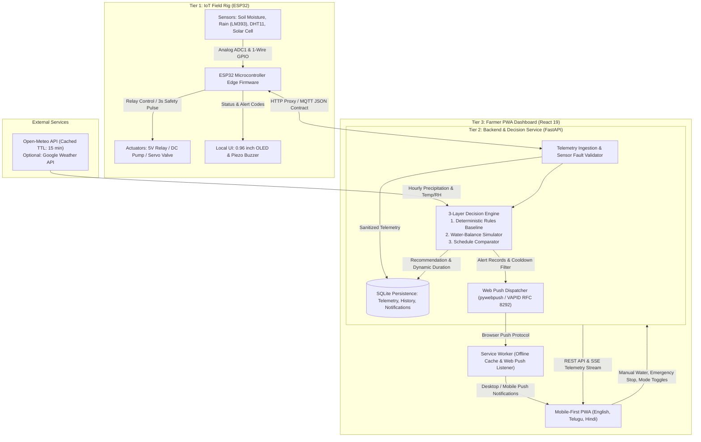

# AquaWise

**Intelligent, weather-aware irrigation decision support for smallholder farming.**

[](LICENSE)
[](https://github.com/kushisafk/AquaWise/actions/workflows/ci.yml)
[](frontend)
[](backend)
[](docs/HARDWARE_GUIDE.md)
[](frontend/public)

Conventional irrigation relies on rigid calendar timers or manual guesswork. When temperature spikes or rain arrives unexpectedly, timer-based systems either overwater—wasting water and washing out soil nutrients—or leave crops under-watered during critical growth windows.

**AquaWise** solves this by uniting real-time ground telemetry, live atmospheric forecasts, and a transparent physical water-balance engine. Instead of complex dashboards filled with raw numbers, it delivers one clear, explainable answer to the farmer's primary question: **Should I water now?**

---

## 🌾 The Problem & The AquaWise Solution

| Challenge in Fixed-Schedule Irrigation | How AquaWise Solves It |
|---|---|
| **Blind Watering During Rain**<br>Timers run regardless of current rainfall or imminent downpours. | **Rain-Aware Suppression**<br>Monitors an active raindrop sensor and short-term rainfall forecasts ($\ge 2.0\text{ mm}$, $\ge 60\%$ probability) to pause watering and let nature irrigate. |
| **Ignoring Soil Water Deficit**<br>Crops are watered on fixed clocks even when the root zone is already saturated. | **Calibrated Moisture Thresholds**<br>Uses capacitive soil moisture sensors calibrated to farmer-defined dry and wet soil baselines ($25\%$ low trigger, $70\%$ target band). |
| **Static Runtime Guesswork**<br>Applies identical runtimes regardless of weather extremes. | **Atmospheric Drying & Dynamic Duration**<br>Evaluates ambient heat, relative humidity (DHT11), and sunlight intensity to calculate the exact minutes needed to reach target moisture. |
| **Unchecked Sensor Failure**<br>Faulty or corroded probes report zero or pegged values, causing severe overwatering. | **Fault-Tolerant Safety Interlocks**<br>Detects open circuits, short circuits, flatlines, and missing telemetry within 3 cycles, degrading gracefully to **CHECK FIELD** with decaying confidence imputation. |

By synthesizing ground-level sensors with upcoming meteorological patterns, AquaWise protects crops against dry stress while actively conserving water resources.

---

## ⚡ Key Capabilities

### 📡 Sensor-Driven Field Monitoring
- **Integrated Hardware Rig**: Interfaces with an ESP32 microcontroller reading a Capacitive Soil Moisture Sensor v1.2, an LM393 Raindrop Detection board, a DHT11 temperature/humidity sensor, and a solar intensity cell.
- **Physical Safety Controls**: Supports direct hardware pump actuation with built-in safety interlocks: 3-second pulse limits in manual mode, cooldown timers between cycles, and opt-in automatic control.
- **Continuous Edge Telemetry**: Streams 1-second telemetry via backend proxy or MQTT contracts, alongside local field diagnostics via an SSD1306 OLED display and acoustic buzzer signals.

### 🧠 Explainable Decision Engine
- **Three Deterministic States**:
  - `WATER NOW`: Soil moisture is below the low threshold with no meaningful rain expected; specifies a targeted run duration and estimated volume.
  - `WAIT`: Soil moisture is adequate, it is currently raining, or beneficial rainfall is forecast within 6 hours.
  - `CHECK FIELD`: Sensor telemetry is invalid, disconnected, or conflicting, preventing risky automated decisions.
- **Transparent Factor Attribution**: Ranks every environmental driver (Soil Moisture, Incoming Rain, Drying Conditions, Sensor Provenance) by its directional effect (`supports`, `delays`, or `caution`) so farmers understand the rationale behind every piece of advice.

### ⏱️ Dynamic Scheduling & Rain Anticipation
- **Deficit-Based Irrigation Runtime**: Instead of static blocks of time, runtimes are calculated dynamically from current soil deficit, calibrated soil capacity, and system flow rate ($L/\text{min}$), bounded by farmer-defined safety duration caps.
- **Forward Horizon Lookahead**: Projects soil moisture depletion across 48 hours to notify farmers when an adequately moist field is expected to cross into dry territory.

### 🛡️ Fault Tolerance & Offline Reliability
- **Multi-Level Degraded States**: Distinguishes `LIVE`, `CACHED`, `STALE`, `UNAVAILABLE`, and `TEST_OVERRIDE` data states. If weather APIs fail, AquaWise flags reduced confidence rather than dangerously assuming zero chance of rain.
- **Progressive Web App (PWA)**: Built with Service Workers to cache application shells and telemetry snapshots, displaying visible offline warnings while locking remote valve actuations during disconnections.
- **Trilingual Farmer Interface**: Complete, native localization in **English**, **Telugu (తెలుగు)**, and **Hindi (हिन्दी)** across all controls, advice banners, and explanation factors.

### 🔔 Integrated Alerting & History Tracking
- **Multi-Channel Notifications**: Stored in a persistent SQLite log with cooldown deduplication (preventing repeated alerts within 15–30 minutes), surfaced via in-app notification badges and standards-based Web Push (RFC 8030 / RFC 8292 VAPID).
- **Audit Logging**: Chronological history tracking sensor readings, decision changes, completed irrigation sessions, and farmer feedback ratings.

---

## 🏗️ System Architecture

The following diagram illustrates the end-to-end data flow across physical hardware, backend services, external weather providers, and user interfaces:



### Data Flow Stages
1. **Environmental Sampling**: The ESP32 samples capacitive soil moisture, raindrop resistance, ambient temperature, relative humidity, and solar voltage every second.
2. **Validation & Fault Detection**: Telemetry is checked against physical hardware limits (ADC floor/ceiling bounds, flatline checks, spike limits). Missing data is imputed with decaying confidence indicators.
3. **Forecast Synchronization**: The backend cross-references field telemetry with cached Open-Meteo forecasts (hourly precipitation, rain probability, and temperature outlooks).
4. **Evaluation & Dynamic Scheduling**: The deterministic rule engine evaluates calibrated soil thresholds against forecast rain. If irrigation is needed, it calculates runtime and volume; otherwise, it delays watering or flags field inspections.
5. **Presentation & Actuation**: Decisions and explanations are streamed via SSE and REST to the farmer dashboard and Web Push tray. Authorized start/stop commands dispatch safety-bounded actuation pulses to the field relay.

---

## 📊 Dynamic Scheduling & Strategy Comparison

AquaWise includes a dedicated comparative analysis engine that evaluates four distinct watering strategies over an identical forward 48-hour horizon:

```
                                  48-HOUR COMPARATIVE EVALUATION
┌────────────────────────┬───────────────────────────────────────────────────────────────────┐
│ Strategy               │ Operational Logic                                                 │
├────────────────────────┼───────────────────────────────────────────────────────────────────┤
│ Fixed Schedule         │ Rigid calendar timer baseline (15 min every 12 hours).            │
│ Moisture Threshold     │ Reactive: Waters 15 min whenever moisture drops below threshold. │
│ Rain-Aware Threshold   │ Reactive + Forecast: Suppresses watering if rain is imminent.     │
│ Optimized Schedule     │ Predictive: Computes exact deficit volume and accounts for rain.  │
└────────────────────────┴───────────────────────────────────────────────────────────────────┘
```

### Calculated Evaluation Metrics
For every 48-hour simulation window, the comparison engine calculates:
- **Estimated Water Consumption ($L$)**: Total modeled water volume based on calibrated flow rate ($L/\text{min}$) and runtime minutes.
- **Water Savings Relative to Baseline ($\%$)**: Modeled percentage reduction in water volume compared directly against the rigid Fixed Schedule baseline.
- **Dry-Stress Hours**: Total simulated hours where soil moisture remains below the crop's calibrated lower threshold.
- **Over-Water Hours**: Total simulated hours where moisture exceeds the healthy root-zone ceiling (target $+ 8\%$).

> [!NOTE]
> **Modeled Projections vs. Physical Metering**: Strategy comparison figures represent hydrological simulations driven by Penman-Monteith drying dynamics and weather forecasts under identical flow assumptions. They are design benchmarks to help farmers visualize water conservation opportunities, not physical flowmeter measurements.

---

## 🛠️ Technology Stack

| Tier / Component | Technology | Role & Purpose |
|---|---|---|
| **Frontend Framework** | React 19 + TypeScript 5.9 | Reactive, type-safe user interface for mobile and desktop screens. |
| **Styling & Icons** | Tailwind CSS + Lucide React | High-contrast, mobile-first design with accessible iconography. |
| **Build & Tooling** | Vite | Ultra-fast client-side bundling with proxy configuration. |
| **State & API Client** | TanStack React Query + Orval | Auto-generated React Query hooks and Zod schemas from OpenAPI specs. |
| **Routing & Architecture** | Wouter | Lightweight client-side routing across Dashboard, Analytics, History, and Settings. |
| **Backend Framework** | FastAPI (Python 3.11+) | High-performance asynchronous REST API and Server-Sent Events (SSE). |
| **Server & Serialization** | Uvicorn + Pydantic v2 | ASGI server runtime and strict request/response data validation. |
| **Database & Persistence** | SQLite3 (WAL Mode) | Embedded local storage for telemetry, calibration, history, and notifications. |
| **Weather Integration** | Open-Meteo API | Primary hyper-local weather forecast provider with automatic SQLite TTL caching. |
| **Weather Fallback** | Google Weather API | Optional secondary forecast provider configured via environment variables. |
| **Edge Hardware** | ESP32-WROOM-32 | Low-power microcontroller managing analog ADC1 reading and relay control. |
| **Field Sensors** | Capacitive v1.2, LM393, DHT11 | Ground moisture, raindrop detection, and ambient climate monitoring. |
| **Push Notifications** | Web Push API + `pywebpush` | Standards-based RFC 8030 / RFC 8292 VAPID push alerts to browser clients. |
| **Modeling & Simulation**| Scikit-learn + Custom Physics | Water-balance simulator and experimental `HistGradientBoostingRegressor`. |

---

## 🔬 Decision Logic & Machine Learning Approach

AquaWise maintains a strict distinction between **deterministic safety logic** and **experimental machine learning**:

```
Decision Pipeline Hierarchy:
[ Layer 1: Deterministic Safety Rules ]  ──>  Primary & Authoritative (Always Active)
                  │
[ Layer 2: Water-Balance Physics Sim ]    ──>  Penman-Monteith Evapotranspiration & Infiltration
                  │
[ Layer 3: Experimental ML Regressor ]   ──>  HistGradientBoostingRegressor (Gated by Baseline MAE)
```

1. **Deterministic Safety Layer (Primary)**:
   All actionable farmer advice (`WATER NOW`, `WAIT`, `CHECK FIELD`) is produced by rule-based algorithms with explicit priority ordering. Safety rules ensure that irrigation is never triggered when active rain is detected, and that pump runtimes are hard-capped by farmer limits.
2. **Physical Water-Balance Simulator**:
   Simulates forward soil moisture dynamics using thermodynamic evaporation principles (temperature, humidity, solar radiation) and rainfall infiltration rates. This transparent physics model provides the baseline for all 48-hour projections.
3. **Experimental Gradient Boosting Model**:
   `backend/forecasting.py` contains an experimental regression model (`HistGradientBoostingRegressor`) utilizing time-series feature engineering (1-hour moisture lag, rolling temperature averages, rate of drying, and an engineered evapotranspiration index $ET_0$).
   - **Promotion Gate**: The model is validated using `TimeSeriesSplit` cross-validation against a naive persistence baseline.
   - **Transparent Fallback**: If the experimental model fails to outperform the persistence baseline on held-out data, the system automatically falls back to the deterministic physical simulator.

---

## 📂 Project Structure

```
AquaWise/
├── backend/                       # FastAPI service & analytical engines
│   ├── main.py                    # REST API endpoints, SSE streams, SQLite persistence
│   ├── engine.py                  # Deterministic decision rules & multilingual reasons
│   ├── forecasting.py             # Physical water balance & experimental ML regressor
│   ├── weather.py                 # Open-Meteo weather client, TTL caching, stale fallback
│   ├── push.py                    # VAPID key management & RFC 8292 Web Push delivery
│   ├── generate_vapid_keys.py     # Cryptographic keypair generation utility
│   └── tests/                     # Comprehensive Pytest suite (API, engine, push, weather)
├── frontend/                      # React 19 Progressive Web App
│   ├── public/                    # Web manifest, icons, and offline Service Worker
│   ├── src/
│   │   ├── pages/AquaWise.tsx     # Unified views: Dashboard, Analytics, History, Settings
│   │   ├── components/            # UI components including Web Push settings & dialogs
│   │   ├── hooks/use-esp32.ts     # Real-time hardware telemetry and pump controls
│   │   ├── locales/               # Trilingual dictionaries: English (en), Telugu (te), Hindi (hi)
│   │   └── lib/esp32.ts           # Hardware calculations and telemetry formatters
│   └── vite.config.ts             # Vite bundler configuration & backend API proxy
├── packages/                      # Shared contracts and generated interfaces
│   ├── api-spec/openapi.yaml      # OpenAPI 3.0 system specification
│   ├── api-client-react/          # Generated TanStack React Query hooks
│   └── api-zod/                   # Generated Zod schema validators
├── docs/                          # Engineering documentation
│   ├── PRD.md                     # Product Requirements Document (IARE HackVerse)
│   ├── ARCHITECTURE.md            # System architecture and data flow specifications
│   ├── HARDWARE_GUIDE.md          # Bill of Materials, ESP32 circuit schematics & MQTT contract
│   └── WEB_PUSH.md                # Push notification architecture and deployment guide
├── LICENSE                        # MIT open-source license
├── main.py                        # Root launcher script for the backend API server
└── pyproject.toml                 # Backend dependencies and test configuration
```

---

## 🛡️ Reliability & Design Considerations

- **Graceful Handling of Sensor Anomalies**: Telemetry readings are vetted against electrical validity boundaries. If a probe unplugs or shorts, readings are marked as estimated, confidence degrades, and the app prompts the farmer to physically verify the field before taking action.
- **Honest Weather Degradation**: When weather services time out or lose internet connectivity, cached forecast records are utilized up to their expiry. If no cache exists, the system flags `WEATHER UNAVAILABLE` with reduced confidence, refusing to invent artificial forecasts.
- **Field Verification in Advisory Mode**: In default Advisory mode, AquaWise never activates machinery autonomously. Recommendations are presented to the farmer for manual review and confirmation.
- **Alert Deduplication & Cooldowns**: Alerts share a centralized database schema where identical notifications trigger a 15–30 minute cooldown window, preventing notification fatigue on farmer devices.
- **Recommendations vs. Physical Actuation**: Recommendations reflect ideal hydrological requirements. When manual or automatic irrigation is triggered, runtimes are strictly constrained by the farmer's maximum duration settings and hardware relay cooldowns.

---

## ⚖️ License & Acknowledgements

- **License**: Distributed under the [MIT License](LICENSE).
- **Origin**: Designed and developed for the **IARE HackVerse Series 2026-27** (*AgriTech Track, Problem Statement 2*).
- **Meteorological Data**: Forecasts provided by the [Open-Meteo](https://open-meteo.com/) open-access weather API.
